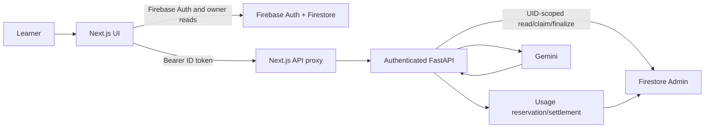

# LearnOS AI — Project Knowledge Base

Repository-grounded handoff for future development assistants. Describes the working tree inspected on **2026-10-12**; it does not establish deployed code/configuration.

## How to read this document

- **Code verified**: visible in current source.
- **Test verified**: covered by a repository test.
- **Reported history**: supplied through project conversation/video/logs, not independently reproduced here.
- **Unknown**: cannot be established from source or checked state.
- `docs/MASTER_SPEC.md` is product vision/roadmap, not an implementation inventory. Prefer source and focused setup docs for current behavior.

## A. Project overview

LearnOS AI is a personalized learning workspace: a learner saves a course goal, receives a syllabus, follows its curriculum, and uses a tutor grounded in the selected topic. The master specification describes a broader mastery-oriented product, but several ideas remain roadmap items.

| Area | Status | Current implementation |
|---|---|---|
| Email/password auth | Implemented | Firebase signup/signin, persistent local session, profile creation, logout. |
| Learning-goal creation | Implemented | Inputs saved in Firestore; authenticated request creates or reuses a syllabus. |
| Personalized syllabus | Implemented | Gemini generation, Pydantic validation, versioned persistence, reuse and failure handling. Quality across different learners still needs evaluation. |
| Course workspace/curriculum | Implemented | Saved syllabus, topic selection, tutor-derived progress markers, timeline editor. |
| AI Tutor | Implemented | Authenticated state/actions, topic conversations and concept progression, chat, browser speech where supported. |
| Mock Test | Implemented, partial | Fixed local demo sets for selected Python, TypeScript and Java categories; generated six-question topic banks for other valid topics after explicit Start. Not comprehensive for all topics. |
| Dashboard progress tabs | Partial | Course list works; AI Tutor/Practice/Notes/Progress tabs render placeholders. Tutor topic status exists in workspace. |
| Diagnostics, adaptive practice, mastery analytics, notes, GCS artifacts, avatar/live voice | Planned/absent | Mentioned in spec/docs, but no corresponding working feature/API was found. |

Tutor confirmations are self-reported understanding, not independently assessed mastery. Static MCQs are not personalized AI questions.

## B. Technology stack

| Layer | Verified technology |
|---|---|
| Frontend | Next.js App Router 16.3.8, React 19.2.8, TypeScript 5, Tailwind CSS 4 |
| Frontend libraries | Firebase JS SDK 12.19.0; lucide-react. No frontend test script/framework in package.json. |
| Backend | Python, FastAPI, Uvicorn, Pydantic, python-dotenv |
| AI | Google Gen AI Python SDK (google-genai); configurable Gemini model, default gemini-3.8-flash |
| Auth/database | Firebase Authentication; Firestore browser SDK and Firebase Admin SDK |
| Tests | Python standard-library unittest, mocks, FastAPI TestClient, fake provider/Firestore |
| Config/deploy | firebase.json maps Firestore rules. No checked-in Cloud Run service, Docker, CI deploy, or Cloud Storage config found. Deployment status unknown. |

AGENTS.md mentions Cloud Storage, Gemini Live and Cloud Run as architecture context. Current requirements do not include Cloud Storage or Gemini Live SDK; docs/TUTOR_SETUP.md says voice uses browser speech APIs, not Gemini Live. Treat older references as planned/documentary unless implementation appears.

## C. Repository structure

```text
LearnOS-AI/
  AGENTS.md                         Development rules
  PROJECT_KNOWLEDGE_BASE.md         This handoff
  firebase.json                     Firestore rules mapping
  firestore.rules                   Client access/ownership policy
  docs/MASTER_SPEC.md               Product vision and roadmap
  docs/SYLLABUS_SETUP.md            Syllabus setup and flow
  docs/TUTOR_SETUP.md               Tutor persistence and browser voice
  backend/app/main.py               FastAPI app/router registration/health
  backend/app/api/dependencies.py   Firebase bearer-token dependency
  backend/app/api/routes/           Syllabus, tutor, AI diagnostic, Mock Test APIs
  backend/app/api/schemas/          Pydantic contracts
  backend/app/core/config.py        Env-derived model, limits and Firebase project
  backend/app/core/firebase.py      Firebase Admin, Firestore, token verification
  backend/app/services/             Provider, usage, research, syllabus, tutor, test logic
  backend/tests/                    Mocked unittest suites
  backend/requirements.txt          Python runtime requirements
  frontend/app/                     Next.js pages and same-origin API proxies
  frontend/components/              Auth form, course syllabus, AI Tutor
  frontend/lib/                     Firebase/auth/data/tutor client helpers
  frontend/package.json             Frontend scripts/dependencies
```

Important files: course creation `frontend/app/dashboard/new/page.tsx` and
`frontend/lib/learning-data.ts`; workspace `frontend/app/dashboard/courses/[goalId]/page.tsx` and
`frontend/components/course-syllabus.tsx`; tutor `frontend/lib/tutor.ts`,
`frontend/components/ai-tutor.tsx`, backend `backend/app/api/routes/tutor.py` and
`backend/app/services/tutor.py`; Mock Test `frontend/app/dashboard/courses/[goalId]/mock-test/page.tsx`,
`frontend/app/api/mock-test/route.ts`, `backend/app/api/routes/mock_test.py`,
`backend/app/services/mock_test.py`; cost control `backend/app/services/ai_usage.py`.

## D. Architecture and request flow

The browser uses Firebase directly for auth and owner-readable records. Model-backed requests go through a same-origin Next.js proxy to FastAPI. Backend validates ID tokens, owns AI calls and Admin Firestore mutations, and validates output before saving.



Course: `createLearningGoal` writes `users/{uid}/learningGoals/{id}` from browser. The form posts only course ID to `/api/syllabus/generate`. Backend reads saved goal, preflights and claims generation, calls Gemini only if no valid syllabus exists, validates, then finalizes a new version.

Tutor: `useTutor` reads `/api/tutor/state`; explicit UI actions post to `/api/tutor/action`. State is transactionally claimed and persisted around model calls; Gemini runs outside the transaction and reply commits only while claim is current.

Mock Test: course/syllabus are observed in UI; bank status reads via `/api/mock-test/bank`. Static sets stay local. Explicit Start for an uncovered topic claims a persistent bank and passes through usage reservation before Gemini. Submit scores generated banks in backend; local demos score in browser.

## E. Frontend routes and navigation

Private pages use client-side Firebase auth checks/redirects; backend APIs independently require Firebase bearer tokens. Direct Firestore access is scoped by rules.

| Route | File | Purpose |
|---|---|---|
| `/` | `frontend/app/page.tsx` | Public landing |
| `/signup`, `/signin` | page files + `frontend/components/auth-form.tsx` | Firebase email/password auth |
| `/dashboard` | `frontend/app/dashboard/page.tsx` | Authenticated course list; other sections are placeholders |
| `/dashboard/new` | `frontend/app/dashboard/new/page.tsx` | Goal form/generation request |
| `/dashboard/courses/[goalId]` | `frontend/app/dashboard/courses/[goalId]/page.tsx` | Workspace and Mock Test entry |
| `/dashboard/courses/[goalId]/mock-test` | `frontend/app/dashboard/courses/[goalId]/mock-test/page.tsx` | Canonical plural Mock Test route |
| `/dashboard/course/[goalId]/mock-test` | `frontend/app/dashboard/course/[goalId]/mock-test/page.tsx` | Singular compatibility redirect to plural route |

Dashboard cards, workspace entry and Back to Course use plural `courses`. The singular alias was added after a reported 404; browser behavior remains unverified. Preserve both unless removal is explicitly approved.

Next proxies: `POST /api/syllabus/generate` → backend generation;
`POST /api/syllabus/research` → research pipeline;
`GET/POST /api/tutor` → tutor state/action;
`GET/POST /api/mock-test` → bank/start/submit.

## F. Backend APIs

All routes except `/health` require Firebase bearer auth (and UID checks). Routers register in `backend/app/main.py`.

| Method/path | Source | Purpose and important behavior | Gemini? |
|---|---|---|---|
| `GET /health` | main | Simple healthy response | No |
| `GET /api/ai/test` | routes/ai.py | Provider connectivity; auth + `AI_TEST_ENDPOINT_ENABLED=true` (default false) | Yes, tracked |
| `POST /api/syllabus/generate` | routes/syllabus.py | Body `CourseSyllabusRequest`; returns versioned syllabus. Reuses valid saved syllabus and has claim/finalize protection. | One normal generation call if not reusable |
| `POST /api/syllabus/research` | routes/syllabus.py | Full learner input; returns research, summary and syllabus. Preflight reuse first. | For new syllabus currently research + summary + generation (3 calls) |
| `GET /api/tutor/state?courseId=...` | routes/tutor.py | Saved state/conversation/status; requires ready syllabus | No |
| `POST /api/tutor/action` | routes/tutor.py | `TutorAction`; revision/operation/pending guards | Conditionally, for teaching actions/transitions |
| `GET /api/mock-test/bank?...` | routes/mock_test.py | Public status, prompts/options; validates owner, version and topic | No |
| `POST /api/mock-test/start` | routes/mock_test.py | Reuse or generate bank after explicit start | Only when no valid bank and budget allows |
| `POST /api/mock-test/submit` | routes/mock_test.py | Deterministic score/review | No |

Proxy timeouts in source: syllabus generation 150s; research 180s (declared maxDuration 150s); tutor 150s; Mock Test start/submit 145s and status read 20s. Hosting/gateway limits may be shorter. Main app normalizes auth failures.

## G. Data model and Firestore

```text
users/{uid}                                  profile
users/{uid}/learningGoals/{goalId}           learner inputs
users/{uid}/courses/{courseId}               backend-managed course/claim
users/{uid}/courses/{courseId}/syllabus/v{N}
users/{uid}/courses/{courseId}/tutor/state
users/{uid}/courses/{courseId}/tutorTopics/{topicId}
users/{uid}/courses/{courseId}/mockQuestionBanks/v{N}_{topicId}
system/ai_usage/daily/{YYYY-MM-DD}
system/ai_usage/monthly/{YYYY-MM}
system/ai_usage/requests/{hashed-feature-request-id}
```

- Legacy-linked courses may contain `sourceLearningGoalId`; backend checks linked goal still exists.
- Syllabus schema (`backend/app/api/schemas/syllabus.py`) stores overview, objective, duration, hours, prerequisites, ordered modules/topics and URLs; sequential IDs and hour totals are validated.
- Tutor state stores syllabus version, active topic, pause/revision, statuses, confirmed modules, operation IDs and pending claim. Per-topic conversation stores concepts/index and up to 20 messages.
- Mock banks contain status/attempt claim and questions with answer/explanation. Public schema hides those fields until submit; scores are not persisted.
- Usage docs contain feature/model/status, reservation, provider metadata/request ID and estimated cost; `ai_usage.py` does not store prompts.

`firestore.rules` grants owner reads for user/course/syllabus/tutor data; client writes to server-managed docs are denied. `mockQuestionBanks` denies all client access because banks contain answer keys. Admin SDK bypasses rules but backend ownership checks remain mandatory. `firebase.json` references rules; deployment is unknown.

## H. Gemini and AI usage — critical

### Provider call paths

| Call path | Trigger | Behavior |
|---|---|---|
| `syllabus_generator.generate_syllabus` → `GeminiProvider.generate_structured` | New eligible course or explicit recovery after failure | One structured request on direct generation path; valid saved syllabus exits before call |
| `course_research.research_course` | Authenticated research pipeline for unsaved syllabus | `TEMP_DIRECT_GEMINI_RESEARCH=True` currently uses direct research-style call, no Search tool; alternate Search branch exists |
| `course_research.summarize_research` | Next research stage | One structured summary call |
| research route → `generate_course_syllabus` | Final research stage | One generation call; three total calls for new research pipeline |
| `tutor.teach` | Accepted start/message/explain/repeat or some transitions | One structured reply per accepted model action |
| `mock_test.start_question_bank` | Explicit Start when no reusable bank | One structured generation after reservation |
| `GeminiProvider.test_connection` via `/api/ai/test` | Authenticated request when flag enabled | Tracked small request; disabled by default |
| `GeminiProvider.count_input_tokens` | No caller found in current app | If invoked, makes external token-count request through guard |

Search of backend source found no other provider SDK caller. Dashboard/workspace reads, syllabus reuse, tutor GET/pause/resume, browser speech and Mock Test read/navigation/submit/retake do not call Gemini on their own.

### Limits, accounting and retries

- Config names include `GEMINI_API_KEY`, `GEMINI_MODEL` (fallback `AI_MODEL`), `AI_DAILY_REQUEST_LIMIT`, `AI_MONTHLY_ESTIMATED_COST_LIMIT_USD`, `AI_MAX_OUTPUT_TOKENS`, price variables, `AI_TEST_ENDPOINT_ENABLED`, Firebase project names and `GOOGLE_APPLICATION_CREDENTIALS`. Values are intentionally omitted.
- Code defaults: 200 requests/day, USD 25 estimated/month, 8192 output tokens. Runtime overrides are unknown. Default pricing is configured in code and may become stale.
- `ai_usage.run_tracked_provider_call` estimates input from UTF-8 prompt bytes and reserves up to twice the output cap before provider call. Firestore transactions enforce daily/monthly caps and request idempotency. Missing pricing, corrupt records or unavailable usage DB fail closed.
- Actual provider input/output/thinking/search metadata and response ID are recorded if available. Missing metadata is unknown, not zero; reservation remains. Estimated cost is not billing.
- Structured generation respects configured output cap; Mock Test asks for cap 1800 bounded by global cap. Generation/research use low thinking setting. SDK retry attempts are zero; application has no automatic model retry.
- Syllabus claims, tutor operation/revision claims and Mock Test attempt claims protect state but cannot guarantee exactly-once external billing on network ambiguity. Explicit retry after uncertain Mock Test timeout may charge again.
- Logs must omit credentials, prompts and learner content. Syllabus timing logs contain random ID, durations/status/reuse; research logs omit query text.

## I. AI Tutor

Sources: `backend/app/api/routes/tutor.py`,
`backend/app/services/tutor.py`, `backend/app/api/schemas/tutor.py`,
`frontend/lib/tutor.ts`, `frontend/components/ai-tutor.tsx` and
`frontend/components/course-syllabus.tsx`.

- Requires authenticated owner course and ready valid syllabus; state is tied to syllabus version.
- Topics follow syllabus order and availability checks. UI statuses come from persisted tutor state, not selection alone.
- Learner must be taught the current concept before confirmation. Final confirmation completes a topic; all topics plus explicit module confirmation complete module. This is not an assessment.
- Model calls run outside state transactions; operation IDs/revisions/pending claims guard duplicate/stale actions. Topic conversation holds up to 20 messages; prompt includes six latest.
- Prompt includes learner/course goal/level/preferences, syllabus objective/prerequisites/additional requirements, selected module/topic/resources, concepts/index, recent messages and actual question. Resource pages are not fetched.
- Voice is browser SpeechRecognition/WebKit recognition and speechSynthesis; recognition may use vendor service. No Gemini Live backend. Browser support/permission varies; chat remains the fallback.
- If action failure and state reload both fail, client may retain busy state until manual reload; see `useTutor.perform`.

See [Tutor setup](docs/TUTOR_SETUP.md).

## J. Mock Test

Canonical UI: `frontend/app/dashboard/courses/[goalId]/mock-test/page.tsx`.
Topics are discovered from saved syllabus modules. Local static matching covers
selected Python fundamentals/variables/data types, TypeScript types/interfaces,
and Java fundamentals/variables/primitive types/type casting/conditional
branching. Static matching includes the selected topic title, module title, and
description when applying category context. This matters for Java Primitive Data
Types: before the fix, the topic title could satisfy the mapping but was omitted
from its context check, causing a valid static set to fall through to the saved
bank status flow. Sets are labeled demo, not personalized; do not imply complete
topic coverage.

Other topics make authenticated read-only bank GET. A `missing` bank permits explicit Start, which sends course/topic/version/attempt UUID. Backend checks owner, ready/current syllabus and topic, reuses valid bank, else claims `mockQuestionBanks/v{version}_{topicId}`, reserves budget, generates one set and validates exactly six unique prompts, four distinct options, one answer index and explanation. Claims last three minutes; stale result cannot overwrite a newer attempt. Later explicit retry may reclaim failed/blocked/uncertain/stale work; no automatic retry.

Public response contains prompts/options only. Submit returns deterministic score/review with answers/explanations. No score persistence or AI on submission/retake/navigation. Client access to bank is denied by rules. Structural validation is not an independent factual validator; production bank count is unknown. A status recheck is a read-only GET and never generates. Browser not tested for this task.

The local Java Primitive Data Types set contains six static questions. Starting,
answering, scoring, results and retake happen locally; there is no score-save
operation. Other uncovered topics use the authenticated saved-bank flow only
when explicitly started. The live Firestore syllabus was not inspected.

## K. Recent regressions and debugging context

### Singular/plural 404
- **Reported:** video showed `/dashboard/course/[goalId]/mock-test` 404.
- **Verified:** canonical page and all normal links use plural `courses`; compatibility page now redirects singular to plural.
- **Status:** source fix present. Browser redirect/render unverified; prior work turn reported lint, TypeScript and diff checks exit 0.
- **Next:** restart Next dev server and visit both paths with authenticated course ID; verify final URL/render/ID. Source compilation is not runtime proof.

### Reported bank 409 and stuck pending state
- **Reported:** browser/log report showed bank status 409, while tutor state returned 200. Production response body and version were not captured.
- **Confirmed source cause for normal generated syllabi:** syllabus persistence adds `generatedAt`, `provider`, `model`, and `syllabusVersion` beside schema fields. `GeneratedSyllabus` rejects extra fields. Before this task, Mock Test validated the raw saved document, unlike tutor and syllabus reuse paths that filter to schema fields; therefore a normally generated saved syllabus could fail Mock Test bank GET with 409. `mock_test._course_context` now validates only declared schema fields. A mocked regression test adds the persistence metadata and expects 200 `missing`, with no provider call.
- **Separate confirmed UI defect:** a failed/timeout Start response had been cached as `pending` indefinitely. It now becomes `unavailable`; the learner can explicitly run a read-only saved-bank GET to learn whether the server completed or failed. No model call is made by the recheck.
- **Still possible:** genuine readiness/version/missing/invalid-syllabus 409 conditions remain intentional safeguards. Production logs do not establish whether the reported 409 came from those or the confirmed metadata mismatch.

### Primitive Data Types selection
- **Confirmed from source:** Java topic mapping required the words for primitive types in the module/description context even when the selected saved topic itself was titled “Primitive Data Types.” Because the selected title was absent from the context string, this could miss the local static bank and unnecessarily enter the saved-bank checking path.
- **Fix:** context matching now includes the selected topic title. The selected Java topic uses the existing six-question static set; page mount and topic selection do not invoke generation for that set.
- **Limit:** no live saved syllabus/browser session was available to verify the reported course record. Frontend has no configured test runner, so this mapping still needs manual browser confirmation.

### Prolonged course loading
- **Verified:** workspace awaits Firestore `getLearningGoal`/`getDoc` and clears loading in finally; syllabus/Mock Test use `onSnapshot`; tutor state GET has 20s browser timeout. Workspace mount itself does not call Gemini.
- **Unknown:** video might show Firebase latency, auth delay, unresolved read or another runtime issue; no browser trace captured.
- **Next:** identify exact loading label and inspect browser Network/Console timing before code changes.

### Dashboard/profile and presentation
- The dashboard greeting uses the authenticated display name first, then the saved profile name, then “Learner”. The sidebar “Workspace” label and repeated learner name were redundant. The header has a compact disclosure with display name, email, and the existing Firebase sign-out action. It closes on Escape or outside pointer interaction; native keyboard Tab moves among controls.
- The dashboard shows saved course count/cards; no extra progress metrics were added because the dashboard does not load reliable per-course progress data.
- Course workspace keeps a `max-w-7xl` readable container and responsive curriculum/tutor panels. Tutor eligibility comes from saved state: paused lessons require resume before teaching actions; Ask focuses the existing question textarea; Explain again uses the existing tutor action.
- Mock Test instructions were shortened; topic/question selection, scoring, generated-bank submission/results, and retake remain as implemented. The Java Primitive Data Types static set has no save stage.

### Worktree state
At turn start, these tracked files were modified: `backend/.env.example`,
`backend/app/api/routes/{ai,syllabus,tutor}.py`,
`backend/app/api/schemas/pipeline.py`, `backend/app/core/config.py`,
`backend/app/main.py`, `backend/app/services/{ai_provider,course_research,syllabus_generator,tutor}.py`,
`backend/gemini_pipeline_probe.py`, `backend/tests/{test_syllabus,test_tutor}.py`,
`firestore.rules`, `frontend/app/dashboard/courses/[goalId]/page.tsx`,
`frontend/app/dashboard/new/page.tsx`, `frontend/components/{ai-tutor,course-syllabus}.tsx`,
and `frontend/lib/learning-data.ts`.

Untracked at inspection: `backend/app/api/routes/mock_test.py`,
`backend/app/api/schemas/mock_test.py`, `backend/app/services/{ai_usage,mock_test}.py`,
`backend/tests/{test_ai_usage,test_mock_test}.py`,
`frontend/app/api/mock-test/route.ts`,
`frontend/app/dashboard/course/[goalId]/mock-test/page.tsx`, and
`frontend/app/dashboard/courses/[goalId]/mock-test/page.tsx`. This document is
newly added on top. During the final UI/functionality pass, edits were also made
to the already-dirty `backend/app/services/mock_test.py`,
`backend/tests/test_mock_test.py`, the existing Mock Test page,
`frontend/app/dashboard/courses/[goalId]/page.tsx`, and the existing
`frontend/components/{ai-tutor,course-syllabus}.tsx`; these include the syllabus
metadata fix, recovery-state UI, and presentation polish. Do not attribute all
working-tree changes to one task or treat the tree as clean. Preserve all edits.

Final UI/functionality pass additionally edited `frontend/app/dashboard/page.tsx`
for visible keyboard focus and longer course-name wrapping.

## L. Environment setup and commands

Prerequisites: Node/npm, Python/pip, Firebase Auth + Firestore project, Firebase Admin ADC or credentials stored outside repo, and Gemini config for model calls. Never copy local values into documentation.

Backend variable names: `GEMINI_API_KEY`, `GEMINI_MODEL`, `AI_MODEL`,
`AI_DAILY_REQUEST_LIMIT`, `AI_MONTHLY_ESTIMATED_COST_LIMIT_USD`,
`AI_MAX_OUTPUT_TOKENS`, `GEMINI_INPUT_PRICE_PER_MILLION_USD`,
`GEMINI_OUTPUT_PRICE_PER_MILLION_USD`, `GEMINI_SEARCH_PRICE_PER_THOUSAND_USD`,
`AI_TEST_ENDPOINT_ENABLED`, `FIREBASE_PROJECT_ID`, `GOOGLE_CLOUD_PROJECT`,
`GCLOUD_PROJECT`, `GOOGLE_APPLICATION_CREDENTIALS`. Frontend names:
`NEXT_PUBLIC_FIREBASE_API_KEY`, `NEXT_PUBLIC_FIREBASE_AUTH_DOMAIN`,
`NEXT_PUBLIC_FIREBASE_PROJECT_ID`, `NEXT_PUBLIC_FIREBASE_STORAGE_BUCKET`,
`NEXT_PUBLIC_FIREBASE_MESSAGING_SENDER_ID`, `NEXT_PUBLIC_FIREBASE_APP_ID`,
server-only `BACKEND_API_URL`. Actual .env values/overrides were not read.

Windows PowerShell examples (install commands are documentation only; no packages were installed here):

```powershell
# Backend setup, from repo root
Set-Location backend
py -m venv .venv
.\.venv\Scripts\python.exe -m pip install -r requirements.txt

# Backend API, from backend/
.\.venv\Scripts\python.exe -m uvicorn app.main:app --host 127.0.0.1 --port 8000

# Backend unit tests, from backend/
.\.venv\Scripts\python.exe -m unittest discover -s tests -v

# Frontend, from frontend/
npm install
npm run dev -- --port 3000
npm run lint
npx tsc --noEmit
npm run build
```

No frontend `test` script is configured. Avoid app actions that trigger model calls unless explicitly requested/budget-approved.

## M. Testing and quality

Backend suites:
- `backend/tests/test_syllabus.py` — schemas, dates, research, provider failure/no retries, reuse/persistence/timing.
- `backend/tests/test_tutor.py` — context, sequence, claims, errors, ownership.
- `backend/tests/test_ai_usage.py` — reservation, limits, duplicates, missing usage/pricing.
- `backend/tests/test_mock_test.py` — validation, reuse, budget, failures, claims, key secrecy, scoring, ownership/version.

Tests mock provider and Firestore; they do not prove browser rendering, deployed rules, Gemini quality, production latency, voice availability or billing.

**Historical results from earlier project turns, not current verification:** full backend `python -m unittest discover -s tests` reported 102 tests OK; frontend `npm.cmd run lint`, `npx.cmd tsc --noEmit` and `git diff --check` reported exit 0 after Mock Test implementation.

**Final UI/functionality pass verification:** `npm.cmd run lint` (frontend) exit 0;
`npx.cmd tsc --noEmit` (frontend) exit 0;
`.\.venv\Scripts\python.exe -m unittest discover -s tests` (from backend) exit 0,
103 tests passed; `git diff --check` (repository root) exit 0. Backend output included a Starlette
TestClient deprecation warning and expected mocked auth/provider log messages.
No browser was available/performed; deployed settings and production bank state
remain unverified. These checks do not prove browser rendering or live latency.

**Follow-up UI/mapping pass:** frontend `npm.cmd run lint`, `npx.cmd tsc --noEmit`,
and repository `git diff --check` all exited 0. `npm.cmd run` confirmed there is
no frontend test script; the Primitive Data Types mapping and account dropdown
still need real-browser verification. No backend source changed in that pass;
the prior 103-test backend result remains the latest backend run.

**UX re-audit pass:** no video file was found in accessible attachments or the
repository, and no browser automation tool is available. `npm.cmd run lint`,
`npx.cmd tsc --noEmit`, and `git diff --check` exited 0. Focused backend
`unittest tests.test_mock_test.MockTestEndpointTests.test_saved_syllabus_generation_metadata_is_ignored_during_validation`
passed (1 test; Starlette TestClient deprecation warning). No live course
document, browser session, deployment, or provider request was accessed.

## N. Security and cost constraints

1. Never disclose secrets in docs, diagnostics, tests or responses.
2. Preserve bearer validation and UID ownership; Admin SDK bypasses rules, so backend checks are essential.
3. Never return Mock Test answer keys before submit.
4. Route provider calls through `run_tracked_provider_call`; do not bypass atomic reservation, idempotency or settlement.
5. Keep automated tests mocked; no live Gemini calls or production writes.
6. No automatic retries/extra model calls without explicit approval and cost/idempotency analysis.
7. Preserve syllabus, tutor, question-bank claims and validation.
8. Inspect status and target diff first; preserve dirty work.
9. No deploy, commit, package installation or production writes without explicit authorization.

## O. Known issues and pending work

| Priority | Item | Evidence/status | Next safe action |
|---|---|---|---|
| P1 | Singular Mock Test route | Redirect source exists; browser verification missing | Restart Next and test singular + plural routes with authenticated course |
| P1 | Mock Test bank 409 | Normal syllabus metadata mismatch is fixed and has a regression test; runtime production status/version 409 still unverified | Run mocked suite; if a live report persists, inspect sanitized detail and syllabus readiness/version without logging IDs or learner data |
| P1 | Mock Test bank status after failed Start | UI now offers explicit read-only status check; browser behavior not verified | Exercise pending/timeout/ready/failed states in a browser without causing an unapproved generation |
| P1 | Course loading duration | Video report; source path known, runtime cause unknown | Reproduce exact label/request and trace timing |
| P1 | Firestore rules deployment | Rules source denies client bank access; deployment unknown | Verify correct project rules and cross-user behavior before demo; do not deploy without approval |
| P2 | Generated MCQ factual quality | Shape validation only | Human-review sample banks; add narrow checks only for reproduced defect |
| P2 | No frontend/browser harness | Package has lint but no frontend test script | Manual browser checks; approval before test tooling |
| P2 | Runtime limits/pricing | Defaults known; overrides unknown and pricing may stale | Verify approved environment/current official pricing without exposing secrets |
| P3 | Product roadmap gaps | Diagnostics/mastery/notes absent or placeholders | Keep outside unrelated fixes |

Production question-bank count was not queried. Do not claim every topic is covered.

## P. Decisions and implementation history

Code-grounded decisions: Firestore is learner-state source; syllabus is versioned and reused; tutor mutations are transactional and replies validated; Mock Test combines mapped static demos with saved topic/version banks; generation is explicit; scores are not saved; answer keys remain server-side until submit; AI use is reserved/settled in Firestore with caps and provider retries disabled; singular route aliases canonical plural route.

Git history contains initial MVP/release commits. Current working-tree diff is uncommitted and must not be attributed to a commit. Video/log details are reported, not runtime-verified facts.

## Q. Instructions for the next LLM

- Read this file and focused docs before modifying code.
- Inspect current `git status --short` and relevant diffs; preserve all dirty work.
- Reproduce/establish root cause; distinguish source, tests, user reports and hypotheses.
- Prefer smallest safe changes; no unrelated refactor.
- Never claim tests, browser checks, deployment or production access unless performed.
- No live Gemini calls in routine tests; use mocks.
- Never expose env values, learner content, tokens or credentials.
- Preserve usage guards, caps, no-retry policy, syllabus reuse, tutor claims, answer-key privacy and ownership.
- No deploy, commit, dependency install or production write without authorization.
- Update this handoff after API, schema, route, security/cost or workflow changes; mark unknowns clearly.
