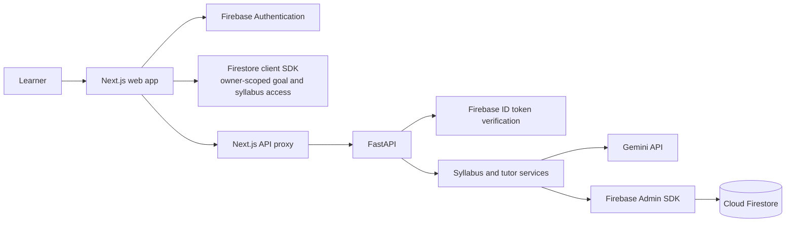

# LearnOS AI

LearnOS AI is a personalized learning platform designed to help learners move from an open-ended goal to a structured path of study. Its long-term direction is a continuous learning loop: understand the learner, map the knowledge needed, teach and practice, collect evidence, and adapt what comes next.

This repository contains the current web application and API. This README distinguishes working capabilities from planned product scope; the product specification remains the source of truth for the full vision.

## Product Status

### Available today

- Email and password sign-up, sign-in, persistent Firebase Authentication sessions, and sign-out.
- Personal learning goals with current level, target timeline, daily study time, preferred learning style, and additional requirements.
- Gemini-generated, schema-validated syllabi saved as versioned course data in Firestore. Learners can retry a failed generation without creating a duplicate goal.
- A course workspace that reads the saved syllabus, shows course setup details, and allows timeline updates and course deletion.
- A syllabus-aware AI tutor that teaches in short back-and-forth steps, waits for learner responses before advancing, answers questions, and adapts examples using saved course history.
- A Gemini Live voice tutor with natural audio input/output, interruptions, typed questions during a live session, and saved text transcripts. The backend issues short-lived Live tokens; the private Gemini API key stays server-side.
- Authenticated Next.js API routes that forward Firebase ID tokens to the FastAPI backend.

Tutor topic and module completion currently depends on learner confirmation. It is not an independent assessment of mastery. Live voice stores transcripts rather than raw audio, and its teaching context uses saved syllabus content and validated notes; listed resource pages are not fetched into the tutor context. Dashboard entries for Practice and Progress / Mastery are placeholders; diagnostic assessments, practice tracking, generated revision notes, and progress reports are not implemented yet.

## Architecture

The application uses a modular monolith: Next.js owns the user experience and same-origin API proxies; FastAPI owns protected business logic, validation, and AI orchestration. Firestore stores learner goals, generated syllabi, tutor state, and course tutor history.



### Responsibilities and safeguards

| Component | Responsibility |
| --- | --- |
| Next.js, React, TypeScript, Tailwind CSS | Responsive application UI, Firebase client authentication, owner-scoped client data access, and API proxy routes. |
| FastAPI | Authenticated API endpoints, request handling, business rules, AI orchestration, and persistence coordination. |
| Gemini | Syllabus generation, tutor explanations, and real-time Live voice. Model selection is configurable on the backend. |
| Firestore | Persistent learner goals, versioned syllabi, tutor conversations, Live transcripts, and tutor progression state. User data is partitioned by Firebase UID. |
| Firebase Authentication / Admin SDK | Client sign-in and backend verification of Firebase ID tokens. |

Structured chat replies are validated before they are saved or used to advance tutor state. Live audio transcripts are saved as conversation history and do not automatically award mastery. Private Gemini credentials and Firebase Admin credentials belong in the backend environment, never in frontend variables. Google Cloud Storage is used for private note images; avatar delivery and a separate vector database are not currently wired into the application.

## Future Scope

The following capabilities are planned and are not represented as completed features:

1. **Diagnostic and adaptive practice:** assess prerequisite knowledge, provide subject-appropriate exercises, respond to mistakes with targeted hints, and save attempt evidence.
2. **Progress reports and mastery insights:** show completed learning, strengths, knowledge gaps, activity over time, and a recommended next action. Any mastery indicator should be evidence-based and clearly described as an application estimate.
3. **Learner notes:** support handwritten notes through an appropriate capture workflow (such as stylus or image input), make them searchable, and connect them to syllabus concepts. Add AI-generated full notes, quick revision, and weak-area summaries as separate, reviewable materials.
4. **Adaptive learning plans:** use learner profile, diagnostic and practice evidence, available study time, and goals to adjust sequence and pacing.
5. **Learning resources and subject-specific activities:** improve authoritative resource discovery and add projects, coding practice, exam simulations, and other activities where appropriate to the subject.
6. **Optional multimodal tutoring:** evaluate richer visual explanations and avatar delivery behind feature flags.

Firestore remains the intended source of truth for learner state. Larger uploaded artifacts may use Google Cloud Storage if and when note capture or other upload features are implemented. Feature development should keep AI output validated and avoid allowing a model to mutate learner state directly.

## Repository Layout

```text
backend/
  app/api/          FastAPI routes, dependencies, and request/response schemas
  app/core/         Backend configuration and Firebase Admin integration
  app/services/     Gemini provider, syllabus generation, and tutor logic
  tests/            Backend unit tests
docs/
  MASTER_SPEC.md    Product requirements and architectural principles
  SYLLABUS_SETUP.md Syllabus configuration, data model, and verification
  TUTOR_SETUP.md    Tutor behavior, persistence, and manual verification
frontend/
  app/              Next.js pages and same-origin API routes
  components/       Reusable UI and learning components
  lib/              Firebase client, auth context, and learning data access
```

## Local Development

### Prerequisites

- Node.js and npm.
- Python and pip.
- A Firebase project with Email/Password Authentication and Firestore enabled.
- A Gemini API key for syllabus generation and AI tutoring.
- Gemini Live voice enabled with `GEMINI_LIVE_ENABLED`, `GEMINI_LIVE_MODEL`, and `GEMINI_LIVE_SESSION_COST_RESERVE_USD` in the backend environment.

### Configure the frontend

In PowerShell, from the repository root:

```powershell
Copy-Item frontend/.env.example frontend/.env.local
```

Set the Firebase web application values in `frontend/.env.local`. Do not put Gemini or Firebase Admin credentials in this file. The frontend uses `http://127.0.0.1:8000` as the backend URL by default; set the server-only `BACKEND_API_URL` if your backend runs elsewhere.

### Configure and run the backend

```powershell
Copy-Item backend/.env.example backend/.env
Set-Location backend
py -m venv .venv
.\.venv\Scripts\python.exe -m pip install -r requirements.txt
```

Set `GEMINI_API_KEY` and, optionally, `GEMINI_MODEL` in `backend/.env`. Set `FIREBASE_PROJECT_ID` and provide Firebase Admin credentials using Application Default Credentials or `GOOGLE_APPLICATION_CREDENTIALS` pointing to a service-account file stored outside the repository.

Start the API from the `backend` directory:

```powershell
.\.venv\Scripts\python.exe -m uvicorn app.main:app --host 127.0.0.1 --port 8000
```

The health endpoint is available at `http://127.0.0.1:8000/health`.

### Run the frontend

In a second terminal, from the repository root:

```powershell
Set-Location frontend
npm install
npm run dev
```

Open `http://localhost:3000`. Before using authenticated course and syllabus reads, configure and deploy the repository's Firestore rules to your Firebase project as described in [Syllabus Setup](../docs/SYLLABUS_SETUP.md). Rule deployment is a separate, explicit Firebase operation; the application does not deploy cloud configuration automatically.

## Verification

Run backend unit tests from the `backend` directory:

```powershell
.\.venv\Scripts\python.exe -m unittest discover -s tests -v
```

Run frontend lint and type checks from the `frontend` directory:

```powershell
npm run lint
npx tsc --noEmit
```

Unit tests use mocked AI and Firebase behavior. Live Gemini calls, deployed Firestore rules, browser audio streaming, and production hosting limits require separate manual verification. See [Syllabus Setup](../docs/SYLLABUS_SETUP.md) and [Tutor Setup](../docs/TUTOR_SETUP.md) for feature-specific checks and known limitations.

## Product and Feature Documentation

- [Master Product Specification](../docs/MASTER_SPEC.md)
- [Syllabus setup and data flow](../docs/SYLLABUS_SETUP.md)
- [AI tutor behavior and persistence](../docs/TUTOR_SETUP.md)
